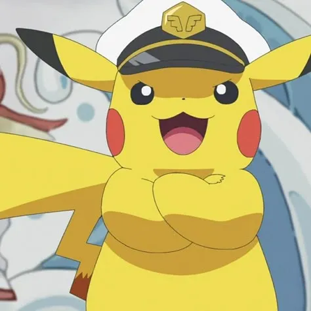
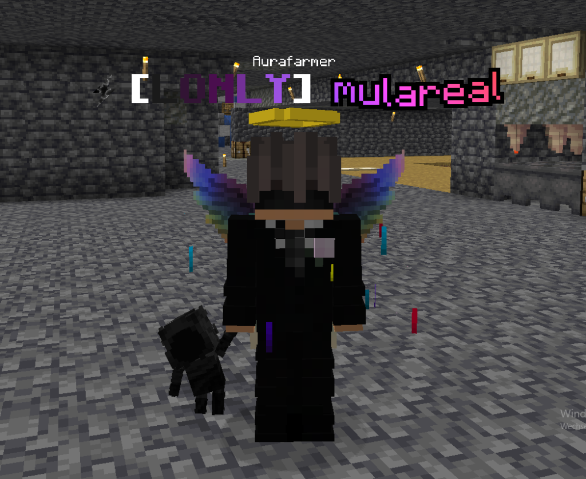
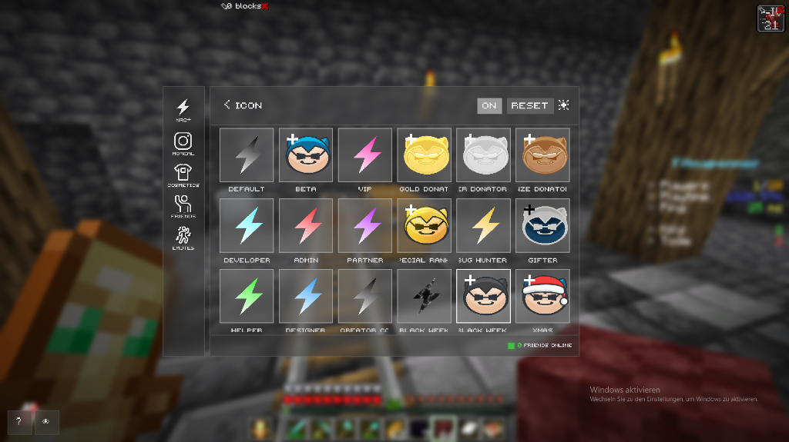
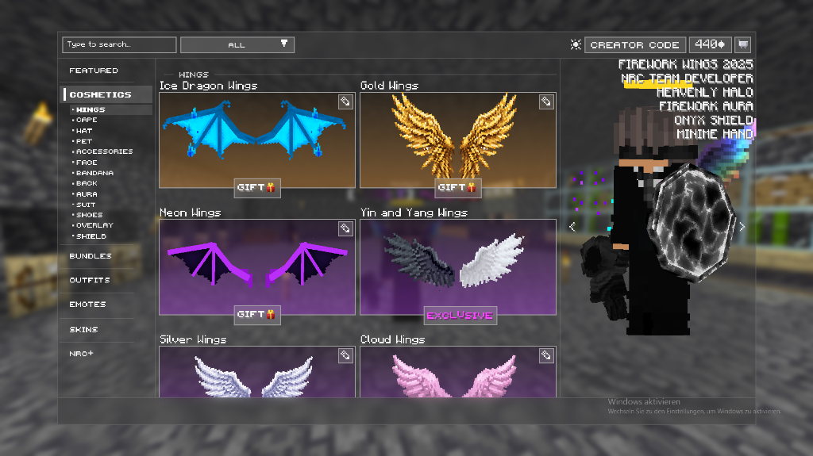
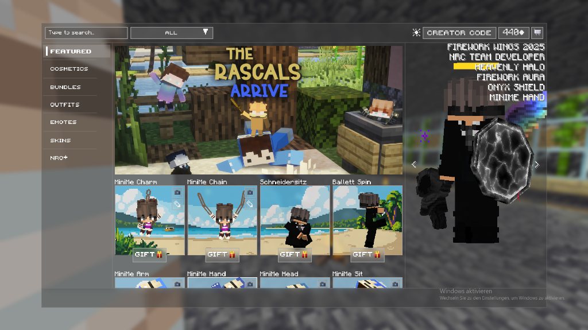

<div align="center">
  

  # NoRisk Cosmetics Unlocker

  A lightweight Fabric mod for NoRisk Client that unlocks all cosmetics, emotes, badges, and NRC+ perks.

  [**Download .jar**](releases/mc26.3/norisk-cosmetics-unlocker-1.0.35-mc26.3.jar) • [**All versions**](releases/README.md) • [**Installation**](#installation) • [**Commands**](#commands) • [**Screenshots**](#screenshots) • [**Build**](#build)
</div>

---

## Screenshots

<div align="center">
  
  
</div>
<div align="center" style="margin-top: 10px;">
  
  
</div>

---

> Not affiliated with or endorsed by NoRisk. Everything happens on your own client: other players don't see your unlocked cosmetics. Use at your own risk.

## Features
- **All Cosmetics**: Unlocks all wings, capes, halos, hats, masks, pets, and tails in the wardrobe. Outfits are saved locally.
- **All Emotes**: Full access to all emotes. Emote wheel and AFK emote survive restarts.
- **All Badges & Crowns**: Choose from all 23 nametag icons.
- **NRC+ Perks**: Custom crosshair editor, projectile particle trails, and nametag formatting.
- **Spotify Nametag**: Works without the Spotify overlay HUD (the "Show your song" checkbox is enough), including the song cover.
- **Update Check**: After a NoRisk update the mod tells you in chat if some of its hooks no longer match (`/nrcu status`).
- **Freeze Watchdog**: Writes a thread dump to `logs/nrc-freeze-*.txt` if the game hangs for 10 s.

## Installation
1. Download [`norisk-cosmetics-unlocker-1.0.35-mc26.3.jar`](releases/mc26.3/norisk-cosmetics-unlocker-1.0.35-mc26.3.jar) (Minecraft 26.3). Other Minecraft versions and older releases: [releases](releases/README.md).
2. Press `Win + R`, paste this path and press Enter (use the name of your NoRisk profile):
   ```
   %APPDATA%\norisk\NoRiskClientV3\data\profiles\Fabric 26.3\mods
   ```
3. Put the `.jar` file into that folder and remove older versions of the mod.
4. Restart your game.

## Commands
Change your nametag icon anytime via chat (or just use the ui):

| Command | Icon |
| :--- | :--- |
| `/nrcicon vip` | VIP Crown |
| `/nrcicon gold` | Gold Donator Crown |
| `/nrcicon silver` | Silver Donator Crown |
| `/nrcicon bronze` | Bronze Donator Crown |
| `/nrcicon dev` | Developer Badge |
| `/nrcicon admin` | Admin Badge |
| `/nrcicon partner` | Partner Badge |
| `/nrcicon special` | Special Rank |
| `/nrcicon bug` | Bug Hunter |
| `/nrcicon default` | Default NoRisk Logo |

Type `/nrcicon` to see your currently selected icon. `/nrcu status` shows the mod version and whether all hooks into NoRisk still work.

## Build

Requirements: JDK 25, Windows with the NoRisk launcher installed (the mod compiles against NoRisk's jars, which are not part of this repo).

```powershell
.\client\setup-libs.ps1     # copies the NoRisk + Kotlin jars from your launcher into client/libs
.\gradlew build             # -> client/build/libs/norisk-cosmetics-unlocker-<version>-mc26.3.jar
```

If Gradle picks the wrong JDK, set `JAVA_HOME` to JDK 25 or add `org.gradle.java.home=<path to JDK 25>` to your user `gradle.properties`.

## After a NoRisk update

NoRisk updates often rename or move classes. Run `setup-libs.ps1` again, rebuild and check `/nrcu status` in game. Broken hooks are listed there and in the log (`Missing NoRisk hooks`). See [CONTRIBUTING.md](CONTRIBUTING.md#after-a-norisk-update).

## How it works

- Mixins into NoRisk's (Kotlin) classes, all with `remap = false` and `defaultRequire: 0`: a renamed NoRisk class only disables that one feature instead of crashing the game. `CompatCheck` reads every mixin's targets and reports the missing ones.
- Ownership checks (wardrobe, shop, emote lists, NRC+ permission) are answered with "owned"; outfits and nametags are stored in `config/` instead of NoRisk's backend.
- Song covers: NoRisk uploads covers to its backend (NRC+ only). The mod stores them locally under the same id (SHA-256) and converts them to PNG, because NoRisk only decodes PNG and WebP.

## Contributing

See [CONTRIBUTING.md](CONTRIBUTING.md).

## License

[MIT](LICENSE)
